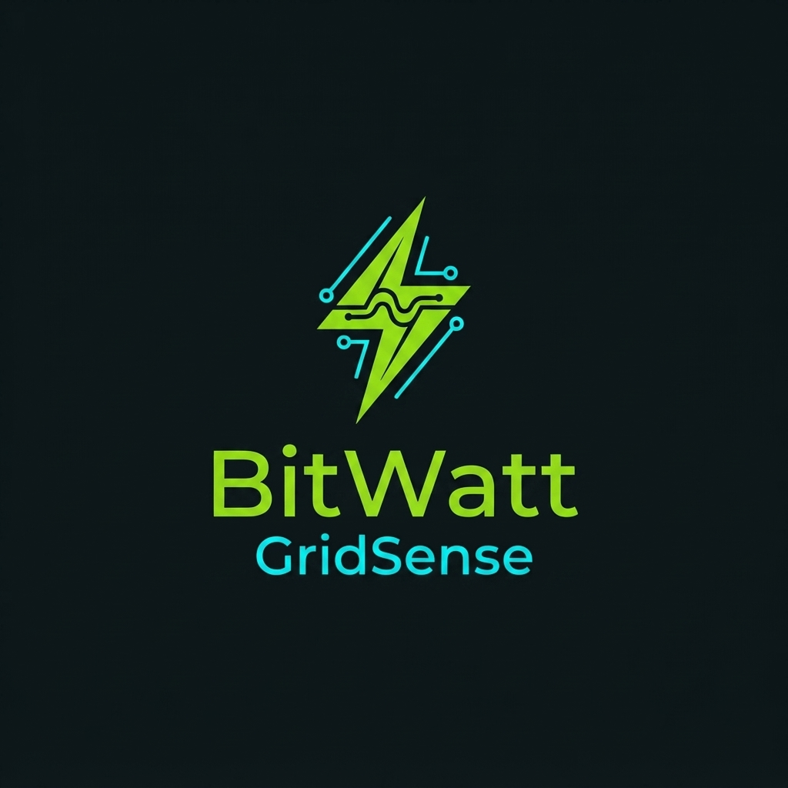

#  BitWatt — GridSense


**Sistema Inteligente de Monitoreo y Gestión Energética** orientado a edificios públicos, institucionales y educativos. 

GridSense captura, centraliza y visualiza el consumo eléctrico con alta frecuencia mediante nodos IoT de bajo costo, transformando lecturas técnicas (kWh) en indicadores accionables de **costo monetario (MXN)**, **impacto ambiental ($\text{CO}_2\text{e}$)** e **Índice de Eficiencia Energética (IEE)** para combatir la gestión reactiva y los consumos hormiga fuera de horario.

---

## 📋 Tabla de Contenidos

- [Problemática y Propuesta de Valor](#-problemática-y-propuesta-de-valor)
- [Arquitectura del Sistema](#-arquitectura-del-sistema)
- [Características Principales](#-características-principales)
- [Modelo de Base de Datos (`bitwatt_db`)](#-modelo-de-base-de-datos--bitwatt_db)
- [Instalación y Despliegue](#-instalación-y-despliegue)
- [Alineación con Sustentabilidad (ODS)](#-alineación-con-sustentabilidad-ods)
- [Equipo de Desarrollo](#-equipo-de-desarrollo)

---

## 🎯 Problemática y Propuesta de Valor

En la mayoría de inmuebles institucionales, el gasto energético se conoce de forma global y tardía a través del recibo mensual o bimestral, generando **ceguera operativa energética**. GridSense resuelve esto mediante:

- **Visibilidad continua:** Seguimiento granular por edificio, piso, zona y circuito eléctrico.
- **Detección de desperdicios:** Identificación de consumos fantasma y equipos encendidos en horarios no operativos.
- **Traducción ejecutiva:** Conversión automática de energía consumida a impacto económico (tarifas base, intermedia y punta) y huella de carbono ($\text{kg CO}_2\text{e}$).
- **Soberanía tecnológica:** Arquitectura basada en hardware abierto y desarrollo interno de bajo costo.

---

## 🏗️ Arquitectura del Sistema

El sistema está desacoplado en capas independientes para facilitar pruebas, escalabilidad y mantenimiento:

| Capa | Tecnologías | Responsabilidad |
| :--- | :--- | :--- |
| **Adquisición (Edge/IoT)** | ESP32 + Sensores no invasivos SCT-013 | Lectura de corriente RMS, calibración básica y empaquetado de telemetría. |
| **Comunicación** | Wi-Fi + Protocolo MQTT | Transporte ligero y de baja latencia desde los nodos físicos hacia el servidor. |
| **Procesamiento (Backend)** | Node.js | Ingesta de telemetría, validación de datos, motor de reglas, cálculo de tarifas/$\text{CO}_2$ y API REST. |
| **Analítica y Optimización** | Reglas Horarias + Algoritmo Genético | Ajuste dinámico de umbrales, detección de anomalías y simulación de ahorro energético. |
| **Persistencia** | MySQL 8.0 (`bitwatt_db`) | Almacenamiento relacional de telemetría cruda, agregaciones horarias/diarias y catálogos. |
| **Visualización (Frontend)** | React + Prototipo UI/UX en Figma | Dashboard ejecutivo, gráficas históricas, gestión de alertas y reportes. |

### Flujo de Datos
```text
[Sensor SCT-013] ──► [Nodo ESP32] ──(MQTT / Wi-Fi)──► [Backend Node.js] ──► [MySQL: bitwatt_db]
                                                             │
                                                             ▼
                                                [Dashboard Web en React]
```

---

## ✨ Características Principales

- **Monitoreo eléctrico granular:** Captura continua de telemetría mediante nodos ESP32 y sensores SCT-013 conectados por MQTT, segmentada por edificio, piso, zona y circuito.
- **Indicadores operativos y ejecutivos:** Traducción automática del consumo en `kWh` a costo estimado en **MXN**, impacto en **$\text{kg CO}_2\text{e}$** e **Índice de Eficiencia Energética (IEE)**.
- **Detección de consumo fuera de horario:** Identificación de cargas residuales ("consumo hormiga") y comportamientos atípicos mediante reglas horarias y umbrales.
- **Optimización y simulación:** Apoyo en analítica y algoritmo genético para refinar umbrales y proyectar escenarios de reducción de consumo.
- **Historial estructurado (`bitwatt_db`):** Almacenamiento relacional en MySQL 8.0 con catálogos, datos crudos y resúmenes temporales para consultas ágiles.
- **Interfaz web en React:** Panel de control con gráficas históricas, estado de nodos/circuitos, alertas y reportes orientados a toma de decisiones.

---

## 🗄️ Modelo de Base de Datos (`bitwatt_db`)

El esquema relacional en **MySQL 8.0** está en [`./database/bitwatt_db_1711.sql`](./database/bitwatt_db_1711.sql) (dentro de la carpeta [`./database/`](./database/)) y organiza la información en bloques separados:

- **Estructura física y zonas:** Catálogos de edificios, pisos, zonas y circuitos eléctricos para ubicar cada medición.
- **Nodos y sensores:** Registro de nodos ESP32 y sensores SCT-013 asociados a sus respectivos circuitos y estados operativos.
- **Telemetría y agregaciones:** Almacenamiento de lecturas eléctricas (`kWh` / corriente / potencia) y resúmenes temporales para consultas rápidas.
- **Tarifas, reglas y alertas:** Parámetros de tarifas (base, intermedia, punta), factores de emisión ($\text{kg CO}_2\text{e}$), umbrales horarios y registro de incidencias.

---

## 🚀 Instalación y Despliegue

El proyecto se plantea de forma progresiva —iniciando con el prototipo de interfaz en Figma y pruebas controladas antes de escalar a piloto institucional y entorno VPS/cloud—. Los comandos exactos de arranque y variables de entorno dependen de la estructura final de carpetas del repositorio (`backend/`, `database/` y `frontend/`):

1. **Clonar el repositorio:**
   ```bash
   git clone [https://github.com/gJhony/BittWatt.git](https://github.com/gJhony/BittWatt.git)
   cd BittWatt
   ```
2. **Preparar la base de datos:**
- Crea la base y carga el esquema desde [`./database/bitwatt_db_1711.sql`](./database/bitwatt_db_1711.sql) en MySQL 8.0 (nota: la documentación de formulación también contempla PostgreSQL en su propuesta inicial).
3. **Configurar y levantar servicios:**
- Configura las credenciales de base de datos, broker **MQTT** y puertos en las variables de entorno del backend (`./backend/`) y del frontend (`./frontend/`).
  - Instala dependencias y ejecuta los servicios correspondientes de backend y frontend en entorno local o en un **VPS** (con dominio y SSL/TLS en etapas posteriores).
4. **Hardware e integración IoT (fase física / piloto):**
- Calibra los sensores **SCT-013** y el nodo **ESP32** sobre red Wi-Fi local y valida la telemetría por MQTT en un circuito controlado antes de ampliar a más zonas.

---

## 🌱 Alineación con Sustentabilidad (ODS)

GridSense se vincula con los Objetivos de Desarrollo Sostenible bajo un enfoque de transparencia de datos y toma de decisiones:

- **ODS 7 — Energía asequible y no contaminante:** Fomenta un uso más consciente y eficiente de la electricidad al hacer visibles consumos en espera ("consumo hormiga"), costos estimados y emisiones en $\text{kg CO}_2\text{e}$.
- **ODS 11 — Ciudades y comunidades sostenibles:** Apoya la gestión energética en edificios públicos, escolares e institucionales para reducir desperdicios operativos y promover hábitos responsables.

El monitoreo por sí solo no reduce el gasto automáticamente; su valor está en entregar evidencia clara para que el personal responsable ajuste horarios, mantenimiento y operación.

---

## 👥 Equipo de Desarrollo

| Integrante | Matrícula | Rol en el Proyecto |
| :--- | :---: | :--- |
| **Ricardo Gadiel Bobadilla Gabriel** | `240349` | Líder del equipo, coordinación y desarrollo Frontend |
| **Margaret Isabela Rojas de Leon** | `240242` | Desarrollo Frontend y documentación técnica |
| **Mario Banda Sánchez** | `240597` | Desarrollo Backend y diseño de bases de datos |
| **Jhonatan Eliel Ibarra Gonzales** | `240080` | Desarrollo Backend y administración de bases de datos |
| **Vanessa Vergara Domínguez** | `240270` | Diseño UI/UX y prototipado en Figma |
| **Harold Alexis Ramírez Peralta** | `240497` | Diseño de experiencia de usuario (UX), navegación e interacciones en Figma |

```mermaid
flowchart TD
    LIDER["👑 <b>Ricardo Gadiel Bobadilla Gabriel</b><br/><i>240349 • Líder del Proyecto, Coordinación y Frontend</i>"]

    LIDER --> FE["💻 <b>Margaret Isabela Rojas de Leon</b><br/><i>240242 • Desarrollo Frontend y Documentación Técnica</i>"]
    LIDER --> BE1["⚙️ <b>Mario Banda Sánchez</b><br/><i>240597 • Desarrollo Backend y Diseño de BD</i>"]
    LIDER --> BE2["🗄️ <b>Jhonatan Eliel Ibarra Gonzales</b><br/><i>240080 • Desarrollo Backend y Administración de BD</i>"]
    LIDER --> UX1["🎨 <b>Vanessa Vergara Domínguez</b><br/><i>240270 • Diseño UI/UX y Prototipado en Figma</i>"]
    LIDER --> UX2["🧭 <b>Harold Alexis Ramírez Peralta</b><br/><i>240497 • Experiencia de Usuario (UX) e Interacciones</i>"]

    classDef leader fill:#163020,stroke:#84CC16,stroke-width:2px,color:#FFFFFF
    classDef member fill:#0F172A,stroke:#38BDF8,stroke-width:1.5px,color:#F8FAFC

    class LIDER leader
    class FE,BE1,BE2,UX1,UX2 member
